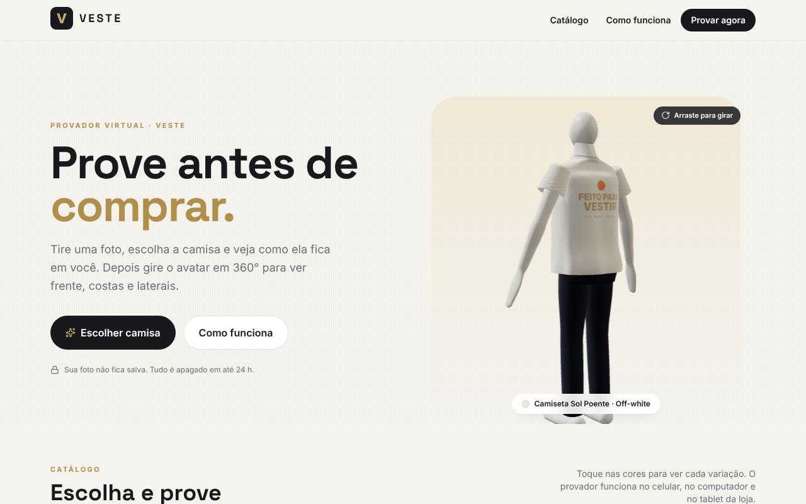
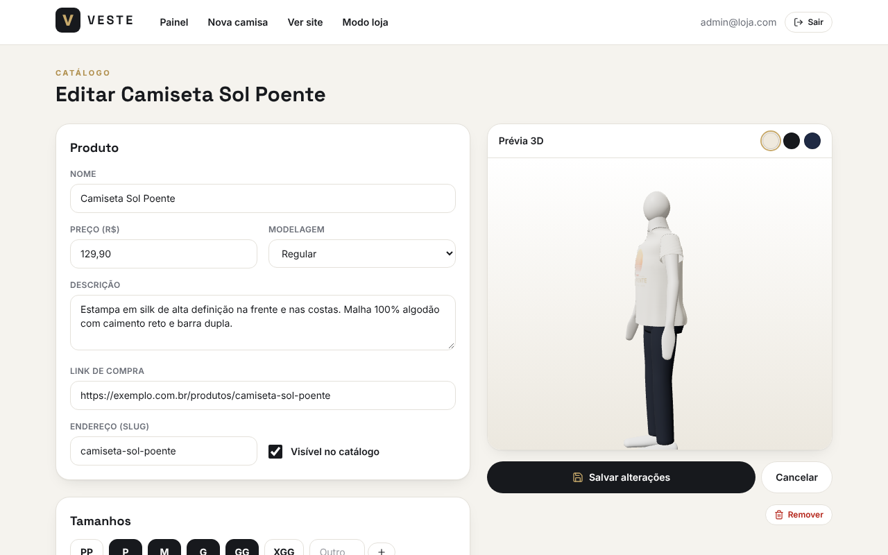

# Provador Virtual de Camisas

Site de provador virtual para loja de camisas. O cliente tira ou envia uma foto, escolhe a camisa e:

1. **vê a camisa vestida na própria foto**, gerada por IA de *virtual try-on*;
2. **gira um avatar 3D em 360°** com as proporções estimadas da foto, e troca cor, tamanho ou camisa na hora, sem tirar outra foto.

Funciona no celular, no computador e num tablet ou TV dentro da loja (`/loja`). Tem painel administrativo (`/admin`), métricas de provas e foi pensado para a LGPD desde o início.



> **Roda sem nenhuma chave de API.** Sem chave, o provador entra em **modo demonstração**: o 360° funciona por completo e a prova em foto vira uma *prévia simulada* gerada no navegador (sem IA, identificada como tal). Com `FASHN_API_KEY`, a prova em foto passa a ser feita por IA.

---

## Sumário

- [O que é realista com uma única foto](#o-que-é-realista-com-uma-única-foto-leia-isto)
- [Rodar localmente](#rodar-localmente)
- [Configurar as chaves de API](#configurar-as-chaves-de-api)
- [Publicar na Vercel](#publicar-na-vercel)
- [Custo por prova](#custo-por-prova)
- [Arquitetura](#arquitetura)
- [Modo loja (quiosque)](#modo-loja-quiosque)
- [Painel administrativo](#painel-administrativo)
- [Privacidade e segurança](#privacidade-e-segurança-lgpd)
- [Modelos 3D e texturas](#modelos-3d-e-texturas)
- [Personalizar a marca](#personalizar-a-marca)
- [Testes](#testes)
- [Estrutura de pastas](#estrutura-de-pastas)

---

## O que é realista com uma única foto (leia isto)

Sendo direto sobre o que cada parte entrega:

| Parte | O que é | Limites |
|---|---|---|
| **Prova em foto (IA)** | Um modelo de IA de *virtual try-on* (FASHN, Kling…) redesenha a sua foto com a camisa. É a parte mais realista. | Pode errar detalhes de estampas pequenas, caimento ou cor. Roupas largas ou casacos na foto atrapalham. |
| **360° (avatar)** | Um **manequim 3D estilizado** cujas proporções (altura, ombros, peito, cintura e quadril) são ajustadas às medidas **estimadas** da foto. | **Não é uma reconstrução do seu corpo.** Uma foto de frente não mostra a profundidade (barriga, costas, postura): as circunferências saem de larguras da silhueta × médias antropométricas. Sem a altura informada, a escala usa uma altura média. Mostra bem **como o tamanho e a modelagem caem** (justa, ideal, solta), não um "gêmeo digital". |
| **Sugestão de tamanho** | Compara o peito estimado com a tabela de medidas da peça (`src/lib/sizes.ts`). | É uma sugestão. Ajuste a tabela à sua grade real. O cliente pode corrigir as medidas na tela ("Medidas do avatar"). |
| **Prévia simulada** (sem chave de IA) | Recolore a roupa da foto com a cor e a estampa, preservando as sombras. Roda 100% no navegador. | É indicativa. A interface sempre a identifica como "Prévia simulada". |

Se a detecção de pose falhar (pessoa de lado, cortada, braços cruzados…), o 360° usa o **avatar padrão do tamanho escolhido** e o cliente é avisado.

Esses avisos também aparecem no próprio site (página inicial, resultado e política de privacidade) e nos comentários do código (`src/lib/body/estimate.ts`, `src/lib/body/parametric.ts`).

---

## Rodar localmente

Requisitos: **Node.js 20.9+** (testado no 22) e npm.

```bash
cd provador
npm install        # também copia o WASM do MediaPipe e baixa o modelo de pose (~9 MB) para public/mediapipe
npm run dev        # http://localhost:3000
```

Pronto. Sem configurar nada:

- o catálogo vem com **3 camisas de exemplo** (gravadas em `.data/db.json` no primeiro acesso);
- o provador roda em **modo demonstração**;
- o painel fica em `http://localhost:3000/admin`, com **usuário `admin@loja.com` e senha `admin123`**, que só valem em desenvolvimento;
- o modo loja fica em `http://localhost:3000/loja`.

> A câmera só funciona em `localhost` ou em **HTTPS** (exigência dos navegadores). Para testar a câmera do celular na sua rede local, use um túnel HTTPS (ex.: `npx localtunnel --port 3000`) ou publique na Vercel.

Comandos úteis:

| Comando | O que faz |
|---|---|
| `npm run dev` | servidor de desenvolvimento |
| `npm run build && npm start` | build e servidor de produção |
| `npm test` | testes automatizados (Vitest) |
| `npm run typecheck` | checagem de tipos |
| `npm run seed` | restaura as camisas de exemplo (`-- --reset` recria o arquivo local; com `DATABASE_URL`, prepara o Postgres) |
| `npm run hash-senha -- "senha forte"` | gera o hash bcrypt para `ADMIN_PASSWORD_HASH` |
| `npm run gerar:modelos` | regenera os `.glb` do manequim e da camiseta base |
| `npm run gerar:imagens` | regenera as estampas, fotos e `seed/camisas.json` de exemplo |

---

## Configurar as chaves de API

Copie `.env.example` para `.env.local` e preencha. **As chaves ficam só no servidor**: nenhuma variável sem o prefixo `NEXT_PUBLIC_` chega ao navegador.

### Prova em foto (IA)

O provedor fica atrás de uma interface (`src/lib/tryon/types.ts`). Trocar de provedor é mudar uma variável; adicionar um novo é implementar dois métodos (`start` e `status`) e registrá-lo em `src/lib/tryon/index.ts`.

| Provedor | Variáveis | Recomendação |
|---|---|---|
| **FASHN AI** (padrão) | `FASHN_API_KEY` (crie em app.fashn.ai → API Keys). Opcional: `FASHN_MODEL` (padrão `tryon-v1.6`) e `FASHN_MODE` (`performance` / `balanced` / `quality`). | ✅ Feito para moda, preserva bem estampas e logos, licença comercial. |
| **Kling Kolors via fal.ai** | `FAL_KEY` | ✅ Alternativa comercial com preço parecido. Saída de 768×1024. |
| **IDM-VTON via Replicate** | `REPLICATE_API_TOKEN` + `REPLICATE_MODEL_VERSION` (hash da versão, na aba "API" do modelo) | ⚠️ **Licença não comercial**: só para testes. Nunca é escolhido automaticamente; exige `TRYON_PROVIDER=replicate`. |

`TRYON_PROVIDER=auto` (padrão) usa a primeira chave configurada, na ordem FASHN e depois fal. `TRYON_PROVIDER=demo` desliga a IA.

> Os campos das APIs seguem a documentação pública de cada provedor. Ao trocar de modelo (por exemplo, para uma versão "Max" da FASHN), confira na documentação se os parâmetros de entrada mudaram e ajuste só o arquivo do provedor (`src/lib/tryon/fashn.ts`).

### Controle de custo

| Variável | Padrão | Efeito |
|---|---|---|
| `TRYON_RATE_LIMIT` | `5/600` | até 5 provas com IA a cada 10 min por IP |
| `TRYON_DAILY_CAP` | `300` | teto diário global de provas com IA (protege a fatura) |
| `KIOSK_RATE_LIMIT` | `120/3600` | limite próprio do tablet da loja |
| `MAX_UPLOAD_MB` | `8` | tamanho máximo da foto. O navegador já reduz para ~1280 px antes de enviar. |

Trocar de cor ou de camisa no 360° **não gasta crédito**. A IA só é chamada quando o cliente pede uma prova em foto.

---

## Publicar na Vercel

1. **Suba o repositório** para o GitHub e importe-o em [vercel.com/new](https://vercel.com/new).
2. Em **Root Directory**, escolha **`provador`** (o app fica nessa pasta do repositório).
3. **Integrações** (aba *Storage* / *Marketplace* do projeto; todas têm plano gratuito):
   - **Neon (Postgres)**: cria a `DATABASE_URL`. As tabelas e as camisas de exemplo são criadas sozinhas no primeiro acesso.
   - **Vercel Blob**: cria o `BLOB_READ_WRITE_TOKEN` (fotos do catálogo e resultados temporários do QR).
   - **Upstash Redis**: cria `UPSTASH_REDIS_REST_URL` e `UPSTASH_REDIS_REST_TOKEN` (ou `KV_REST_API_*`), para o rate limit valer entre todas as instâncias.
4. **Variáveis de ambiente** (Settings → Environment Variables):
   - `APP_SECRET`: gere com `node -e "console.log(require('crypto').randomBytes(32).toString('base64url'))"`.
   - `ADMIN_EMAIL` e `ADMIN_PASSWORD_HASH`: gere o hash com `npm run hash-senha -- "sua senha"`.
   - `FASHN_API_KEY` (ou `FAL_KEY`).
   - `CRON_SECRET`: qualquer texto aleatório. A Vercel o envia ao cron de limpeza.
   - `KIOSK_TOKEN`: se for usar o modo loja.
   - Dados da marca e da LGPD (`NEXT_PUBLIC_*`). Veja `.env.example`.
5. **Deploy.** O `vercel.json` já agenda o cron diário `/api/cron/limpeza`.

Sem banco configurado, o app ainda funciona na Vercel, mas guarda os dados **em memória**: o cadastro se perde a cada novo deploy. O painel mostra esse alerta em "Configuração".

Limites a conhecer: o corpo de uma requisição para uma função da Vercel tem no máximo **4,5 MB**. Por isso o navegador comprime a foto (para ~300–600 KB) e o admin envia uma imagem por vez.

---

## Custo por prova

Estimativa em **novembro de 2026**. Confira os preços atuais nas páginas de cada provedor antes de decidir. Câmbio usado: **US$ 1 ≈ R$ 5,80**.

| Item | Custo por prova com foto |
|---|---|
| IA de try-on: **FASHN v1.6** (sob demanda) | **US$ 0,075 ≈ R$ 0,44** |
| IA de try-on: FASHN "Try-On Max" (mais qualidade) | ~US$ 0,15 ≈ R$ 0,87 |
| IA de try-on: Kling Kolors via fal.ai | ~US$ 0,07 ≈ R$ 0,41 |
| IA de try-on: IDM-VTON no Replicate (só testes, não comercial) | ~US$ 0,024 |
| Vercel (função + banda), Neon, Upstash, Blob | ≈ R$ 0,00 nos planos gratuitos para uma loja pequena. O QR do modo loja grava ~200 KB por até 30 min. |
| 360°, detecção de pose e prévia simulada | **R$ 0,00**: rodam no aparelho do cliente |

**Resumo: cerca de R$ 0,45 por prova com IA (FASHN v1.6).** Exemplos: 1.000 provas por mês dão cerca de R$ 440; 5.000 provas por mês, cerca de R$ 2.200. O painel mostra o custo estimado dos últimos 7 dias, e o `TRYON_DAILY_CAP` impede surpresas.

---

## Arquitetura

```
Navegador (celular, computador ou tablet)          Servidor (Next.js na Vercel)
──────────────────────────────────────────          ─────────────────────────────
Câmera (getUserMedia) ou upload
  └─ reduz a foto e remove EXIF/GPS (canvas)
MediaPipe Pose (WASM, no aparelho)
  ├─ 33 pontos do corpo + silhueta
  └─ estimativa de medidas ──► avatar 3D
        (src/lib/body/estimate.ts)
React Three Fiber (360°)
  ├─ manequim .glb + morph targets
  └─ camiseta-base.glb + textura do produto
        (cor + estampa + padrão em canvas)

POST /api/tryon  (foto + camisa + consentimento) ──► valida o tipo real, reduz, apaga metadados
                                                     rate limit por IP + teto diário
                                                     conta a prova (métrica anônima)
                                                     TryOnProvider.start() ──► FASHN / fal / Replicate
◄── token assinado (HMAC) do job
GET /api/tryon/status?job=…  (polling) ───────────► provider.status() ──► imagem pronta
◄── imagem (data URI; a foto não é gravada)
Sem IA configurada ──► prévia simulada no navegador

Modo loja: POST /api/resultados ──► Blob privado (expira em 30 min) ──► QR code ──► /r/<token>
Admin: proxy.ts (JWT em cookie httpOnly) ──► /api/admin/* (CRUD, upload) ──► Postgres + Blob
```

Principais decisões:

- **Provedor de IA atrás de uma interface**: `TryOnProvider { start, status }`. O job é devolvido ao cliente como **token assinado**, então ninguém consulta o resultado de outra pessoa nem faz o servidor buscar uma URL arbitrária.
- **Um único modelo 3D de camiseta** para todo o catálogo: cada produto vira uma **textura** (cor + estampa na frente e nas costas + padrão corrido), composta em canvas na escala real do tecido.
- **Morph targets** no manequim e na camiseta (`ombros`, `peito`, `cintura` e `quadril`, cada um com versões ± e mais `folga` ± na camiseta). Trocar de tamanho anima o caimento, de justa a solta.
- **Armazenamento plugável**: arquivo local, memória ou Postgres; pasta local ou Vercel Blob; memória ou Upstash. Escolhido automaticamente pelas variáveis de ambiente.

---

## Modo loja (quiosque)

Abra `/loja?chave=<KIOSK_TOKEN>` uma vez no tablet ou TV (o token fica salvo no aparelho e sai da barra de endereço). Fluxo:

1. **Tela de atração** com a câmera ao vivo em espelho: "Toque para começar". O primeiro toque ativa a tela cheia.
2. Catálogo com botões grandes, depois a câmera com contorno-guia e temporizador de 3 s.
3. Confirmação: pose detectada, modelo do avatar e consentimento LGPD.
4. Resultado: foto (antes e depois), 360° e **QR code** para o cliente levar a imagem no próprio celular. O link expira em `RESULT_TTL_MINUTES` (padrão 30 min, máximo 24 h) e o cliente pode apagá-lo na hora.

**Após 60 s sem toque**, aparece o aviso "Ainda está aí?" com contagem regressiva, e a sessão é reiniciada: foto, pose, medidas, resultados e QR são apagados da memória. Enquanto a IA processa, o contador fica pausado. A imagem do QR continua no servidor só até expirar, para o cliente terminar o download.

Dicas: use o modo "fixar app" ou "acesso guiado" do tablet, tripé na altura do peito e boa iluminação frontal.

---

## Painel administrativo

`/admin` (protegido por login; sessão de 8 h em cookie httpOnly assinado):

- **Métricas**: provas hoje, nos últimos 7 dias, no total e no tablet; gráfico diário de 14 dias; provas com foto e vistas 360° por camisa; custo estimado da IA.
- **Configuração**: mostra o que está ligado (IA, banco, arquivos, rate limit, quiosque, senha) e o que falta.
- **Camisas**: cadastrar, editar e remover: nome, preço, modelagem (slim, regular ou oversized), tamanhos, cores (com foto opcional por cor), galeria, estampa da frente e das costas (PNG transparente), padrão corrido, largura e posição da estampa e link de compra, **com prévia 3D ao vivo**.


- Cores sem foto ganham **uma imagem da peça gerada automaticamente** a partir da cor e da estampa, porque a IA de try-on precisa de uma imagem da peça. Fotos reais "flat lay" em fundo claro dão resultados melhores.

---

## Privacidade e segurança (LGPD)

- **Consentimento específico e destacado** antes de enviar a foto (checkbox e link para `/privacidade`). O servidor também recusa envios sem consentimento.
- **A foto não é armazenada por padrão**: é normalizada em memória, enviada ao provedor de IA e descartada. A detecção de pose e as medidas ficam **no aparelho**.
- **Tudo apagado em até 24 h**: o único arquivo temporário é a imagem do QR no modo loja (padrão 30 min). Ela é apagada (1) pela leitura, que recusa arquivos vencidos; (2) pela limpeza que roda a cada novo envio; (3) pelo cron diário; e (4) pelo `ttlDays` do Blob, como garantia extra. O cliente pode apagá-la na hora.
- **Validação de upload**: tipo real pelo cabeçalho do arquivo (JPG, PNG ou WebP; um SVG disfarçado é recusado), tamanho máximo, dimensão mínima e limite de pixels. Tudo é reprocessado com o sharp, que **remove EXIF e GPS**.
- **Rate limit** por IP (o IP só é usado como HMAC, nunca guardado em claro), limite próprio do quiosque e teto diário global.
- **Métricas anônimas**: só contagens por camisa e por dia.
- Cabeçalhos de segurança (`Permissions-Policy` permite câmera só no próprio site, `X-Frame-Options`, `nosniff`), cookies httpOnly, senha do admin em bcrypt e comparação em tempo constante.
- A página `/privacidade` é um **modelo**: preencha razão social, CNPJ, encarregado e e-mail (`NEXT_PUBLIC_*`), confira a política de retenção do provedor de IA escolhido e **revise com um advogado**.

---

## Modelos 3D e texturas

Os modelos ficam em `public/models/` e são gerados por código (`npm run gerar:modelos`, a partir de `src/lib/body/parametric.ts`):

| Arquivo | Conteúdo |
|---|---|
| `manequim-masculino.glb`, `manequim-feminino.glb` | Manequim estilizado (pele, calça e tênis em materiais separados) com 8 morph targets |
| `camiseta-base.glb` | Nós `Camiseta_masculino` e `Camiseta_feminino`, com UV em atlas e 10 morph targets |
| `camiseta-uv-guia.png` | Guia do atlas de textura (frente, costas, mangas e gola) para designers |

O atlas representa **1,6 m × 1,6 m de tecido** (2048 px, cerca de 0,8 mm por px). Por isso a estampa cadastrada com "26 cm" aparece com 26 cm na peça. Frente e costas são mapeadas por comprimento de arco, como o tecido plano que envolve o corpo.

**Trocar por modelos feitos por um artista 3D** é possível sem mexer no código, desde que o novo `.glb` mantenha os mesmos nomes de nós e de morph targets e o mesmo layout de UV (veja o guia).

---

## Personalizar a marca

| O quê | Onde |
|---|---|
| Nome, slogan, cidade, dados da LGPD | variáveis `NEXT_PUBLIC_*` ou `src/lib/brand.ts` |
| Cores | bloco `@theme` em `src/app/globals.css` (padrão: grafite `#17191d` e dourado `#c7a96b`, a mesma paleta do `index.html` deste repositório) |
| Logo | `src/components/Logo.tsx` e `public/logo.svg` (hoje um monograma provisório) |
| Fontes | `src/app/layout.tsx` (Space Grotesk e Inter) |
| Tabela de tamanhos | `src/lib/sizes.ts` |

O nome **"VESTE"** é provisório e foi usado nas telas e estampas de exemplo. Troque por `NEXT_PUBLIC_STORE_NAME`.

---

## Testes

```bash
npm test
```

São 27 testes, cobrindo:

- **gerador 3D**: as circunferências saem exatas, a topologia é estável (requisito dos morphs) e as malhas são válidas;
- **estimativa de medidas** com silhuetas sintéticas: silhuetas maiores dão medidas maiores, braços colados são tratados e a falha sem pose é controlada;
- **morphs**: corpo base com influência zero, invariância à altura e os alvos ±;
- **tamanhos e caimento**;
- **segurança**: tokens adulterados ou expirados são recusados, o EXIF é removido, o tipo real do arquivo é conferido, o rate limit funciona e URLs perigosas são recusadas no cadastro;
- **provedores de IA com `fetch` simulado**: formato das requisições da FASHN e do fal, polling, erros e bloqueio de URLs fora da fila do fal.

O fluxo completo também foi verificado no navegador (Chromium headless): catálogo, upload, pose, prévia, 360°, troca de camisa, download do cartão, modo loja com câmera simulada, QR code, reinício após 60 s e admin.

---

## Estrutura de pastas

```
provador/
├── public/
│   ├── models/          # .glb do manequim e da camiseta + guia de UV
│   ├── seed/            # estampas e fotos das camisas de exemplo
│   └── mediapipe/       # (gerado no npm install) WASM + modelo de pose
├── seed/camisas.json    # catálogo inicial
├── scripts/             # gerar modelos, imagens, seed, hash de senha
├── src/
│   ├── app/
│   │   ├── (site)/      # catálogo, /provar/[slug], /privacidade, /r/[token]
│   │   ├── loja/        # modo quiosque
│   │   ├── admin/       # login + painel
│   │   └── api/         # tryon, status, resultados, eventos, admin, cron
│   ├── components/      # UI (tryon/, three/, kiosk/, admin/)
│   ├── hooks/           # pose, try-on, compartilhar, inatividade
│   ├── lib/
│   │   ├── body/        # gerador paramétrico, estimativa, morphs
│   │   ├── tryon/       # interface + FASHN, fal (Kling) e Replicate
│   │   ├── client/      # pose (MediaPipe), textura, prévia simulada, cartão
│   │   └── db/          # repositório: arquivo, memória ou Postgres
│   └── proxy.ts         # proteção do /admin (no Next 16, o antigo middleware)
└── tests/
```

Stack: Next.js 16 (App Router, Turbopack), React 19, TypeScript, Tailwind CSS 4, Three.js, React Three Fiber e drei, MediaPipe Tasks Vision, Zustand, sharp, zod, jose e bcryptjs, Neon, Vercel Blob, Upstash.
